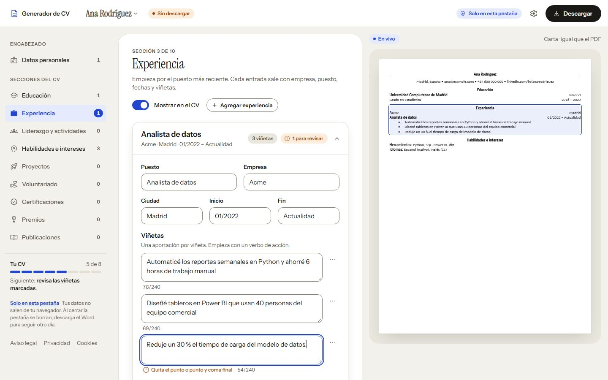
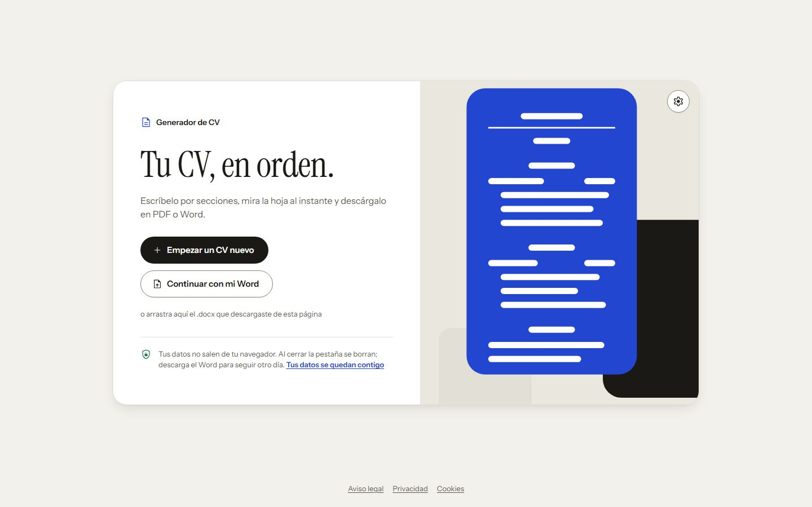
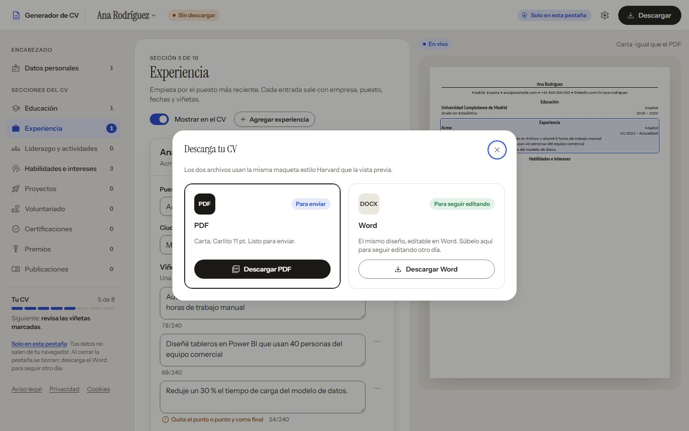
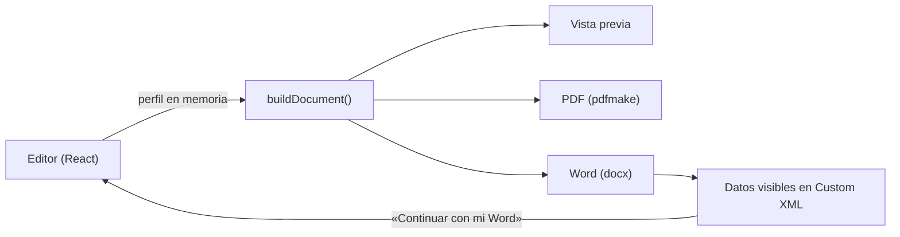

<div align="center">

# Generador de CV

**Escribe tu CV por secciones, míralo al instante y descárgalo en PDF o Word.<br>
Todo ocurre en tu navegador: sin cuentas, sin servidor y sin guardar tus datos.**

[](https://github.com/eddieisoffline/generador-cv/actions/workflows/ci.yml)
[](LICENSE)
[](package.json)
[](src/i18n)



</div>

## Contenido

- [Características](#características)
- [Privacidad por diseño](#privacidad-por-diseño)
- [Empezar](#empezar)
- [Publicar en Vercel](#publicar-en-vercel)
- [Arquitectura](#arquitectura)
- [Calidad](#calidad)
- [Páginas legales y SEO](#páginas-legales-y-seo)
- [Versión Streamlit](#versión-streamlit)
- [Contribuir](#contribuir)
- [Licencia](#licencia)

## Características

- **Editor por secciones.** Datos personales, educación, experiencia, liderazgo,
  habilidades e intereses, proyectos, voluntariado, certificaciones, premios y
  publicaciones. Cada sección se puede ocultar del CV sin borrarla.
- **Vista previa en vivo.** La hoja usa la misma maqueta que el PDF y el Word y
  marca la sección que estás editando.
- **Exportación a PDF y Word.** Formato Carta, estilo Harvard, Carlito/Calibri a
  11 pt. El PDF se genera en el navegador con texto seleccionable y sin
  ligaduras, para que lo lean bien los sistemas que filtran CV (ATS).
- **Seguir otro día sin cuentas.** El Word descargado lleva una copia de los
  datos; súbelo y el editor vuelve tal como lo dejaste.
- **Revisión de viñetas.** Avisos sobre verbos de acción, primera persona,
  longitud y puntuación, con un contador de caracteres.
- **Bilingüe y accesible.** Interfaz y títulos del CV en español e inglés,
  temas claro y oscuro, uso con teclado, diseño adaptable y sin infracciones de
  axe-core (WCAG 2.1 AA).

<table>
  <tr>
    <td width="50%"></td>
    <td width="50%"></td>
  </tr>
  <tr>
    <td align="center">Inicio</td>
    <td align="center">Descarga en PDF o Word</td>
  </tr>
</table>

## Privacidad por diseño

| Garantía | Cómo se cumple |
| --- | --- |
| Nada se envía | La web es estática. El editor y las exportaciones (pdfmake, docx) corren en el navegador. |
| Nada se guarda | Sin cookies, `localStorage`, `sessionStorage` ni IndexedDB. Al cerrar la pestaña el CV se borra; si hay cambios sin descargar, el navegador avisa. |
| Lo impide el navegador | `vercel.json` sirve una CSP con `connect-src 'none'` y `form-action 'none'`: la página no puede conectarse a ningún servidor después de cargar. Fuentes e íconos están dentro del sitio. |
| Solo viaja lo visible | El Word lleva los datos del CV en una parte Custom XML estándar (`urn:generador-cv:perfil`), solo con las secciones visibles. |
| Lo vigilan las pruebas | `tests/privacy.test.ts` falla si el código usa almacenamiento o red. |

Detalles del formato de datos y de cada capa en [docs/ARCHITECTURE.md](docs/ARCHITECTURE.md).

## Empezar

**Requisitos:** Node.js 22.12 o superior.

```bash
git clone https://github.com/eddieisoffline/generador-cv.git
```

```bash
cd generador-cv
```

```bash
npm install
```

```bash
npm run dev
```

| Comando | Qué hace |
| --- | --- |
| `npm run dev` | Servidor de desarrollo en `http://localhost:5173` |
| `npm test` | Pruebas unitarias (Vitest) |
| `npm run build` | Comprueba tipos y genera `dist/` |
| `npm run preview` | Sirve `dist/` en `http://localhost:4173` con las mismas cabeceras que Vercel |
| `npm run check:links` | Revisa enlaces y anclas de `dist/` (`-- --external` incluye los externos) |
| `npm run lighthouse` | Mide la portada servida por `npm run preview` |
| `npm run profile-to-docx` | Convierte perfiles JSON de la versión Streamlit a Word con datos |

## Publicar en Vercel

1. Importa el repositorio en Vercel (**Add New → Project**).
2. Despliega. `vercel.json` ya define el framework (Vite), el build, la carpeta
   `dist`, las cabeceras de seguridad y las URL limpias.

**Variables de entorno opcionales:**

| Variable | Para qué |
| --- | --- |
| `SITE_URL` | URL pública para canonical, Open Graph y sitemap. Si falta, se usa `VERCEL_PROJECT_PRODUCTION_URL`, que Vercel define solo. |
| `GOOGLE_SITE_VERIFICATION` | Código de la meta etiqueta de Google Search Console. |

No actives Vercel Web Analytics ni Speed Insights: añaden scripts que la CSP bloquea y
contradicen la promesa de no recoger datos.

## Arquitectura



Un perfil vive solo en memoria. `buildDocument` lo convierte en una lista de
líneas (encabezado, secciones, entradas y viñetas) y tres renderizadores la
dibujan: la vista previa, el PDF y el Word. Así lo que se ve es lo que se
exporta. Más detalle en [docs/ARCHITECTURE.md](docs/ARCHITECTURE.md).

```
src/
  model/       perfil (tipos, lectura tolerante, visibilidad) y secciones
  lib/         validador de viñetas y formato de fechas y enlaces
  document/    buildDocument: una maqueta para la vista previa, el PDF y el Word
  export/      Word (docx + datos incrustados), PDF (pdfmake) y lectura del Word
  components/  interfaz en React con el sistema de diseño
  i18n/        textos en español e inglés
  styles/      tokens, componentes, app y páginas estáticas
site.config.ts contacto, fecha de los textos legales y metadatos de cada página
vite/          plugin que genera metas, JSON-LD, sitemap y robots
*.html, en/    portada, páginas legales y 404
tests/         Vitest
scripts/       comprobación de enlaces y conversión de perfiles
streamlit-app/ versión anterior en Python, para uso local
```

## Calidad

| Comprobación | Herramienta | Resultado actual |
| --- | --- | --- |
| Pruebas unitarias | Vitest | Modelo, validador, maqueta, Word (ida y vuelta), PDF, privacidad y sitio |
| Tipos | TypeScript (`strict`) | Sin errores |
| Accesibilidad | axe-core en 7 páginas, editor y diálogos, en claro y oscuro, a 360, 768 y 1440 px | Sin infracciones |
| Enlaces | `npm run check:links` | Sin enlaces rotos |
| Rendimiento y SEO | Lighthouse (móvil) | Rendimiento 99–100, Accesibilidad 100, Buenas prácticas 100, SEO 92¹ |

¹ Lighthouse no puede leer `robots.txt` porque lo pide desde la página y la CSP lo
bloquea. El archivo existe y los buscadores lo leen sin problema.

La integración continua (`.github/workflows/ci.yml`) compila, ejecuta las pruebas y
revisa los enlaces en cada push y pull request.

## Páginas legales y SEO

- **Textos legales** en español e inglés, para España y la UE (RGPD, LSSI-CE):
  - [aviso legal](aviso-legal.html) / [legal notice](en/legal-notice.html)
  - [privacidad](privacidad.html) / [privacy](en/privacy.html)
  - [cookies](cookies.html) / [cookies](en/cookies.html)
  - una 404 bilingüe

  No hay banner de cookies porque el sitio no usa cookies.
- **Metadatos:** `site.config.ts` concentra el contacto, la fecha de los textos y
  el título y la descripción de cada página. `vite/site-plugin.ts` genera con eso
  canonical, Open Graph, `hreflang`, JSON-LD `WebApplication`, `sitemap.xml` y
  `robots.txt`.
- **Google Search Console:**
  1. Verifica la propiedad por DNS o con `GOOGLE_SITE_VERIFICATION`.
  2. Envía `/sitemap.xml`.
- **Imágenes:** `favicon.ico`, los íconos y `og-image.jpg` se generaron a partir de
  `public/favicon.svg`. Una prueba falla si alguna imagen de `public/` supera 100 KB.

## Versión Streamlit

La primera versión, en Python con Streamlit, sigue en [`streamlit-app/`](streamlit-app)
para uso local. Sus perfiles JSON se pueden convertir a un Word que la web abre:

```bash
npm run profile-to-docx -- streamlit-app/profiles/mi_perfil.json --out streamlit-app/exports
```

El título profesional, el resumen y las secciones ocultas no pasan al Word, porque
ninguna de las dos versiones los exporta.

## Contribuir

Las contribuciones son bienvenidas. Lee [CONTRIBUTING.md](CONTRIBUTING.md) antes de
abrir un pull request y respeta el [código de conducta](CODE_OF_CONDUCT.md). Para
informar de un problema de seguridad, sigue [SECURITY.md](SECURITY.md) en lugar de
abrir un issue. Los cambios de cada versión están en [CHANGELOG.md](CHANGELOG.md).

## Licencia

[MIT](LICENSE) © 2026 eddieisoffline.

**Recursos de terceros:**

- Instrument Sans, Instrument Serif y Carlito: SIL Open Font License 1.1
  (`public/fonts/licenses`). El PDF usa una versión reducida de Carlito con el
  nombre «CV Doc Sans», como exige su licencia
  ([detalles](src/export/fonts/README.md)).
- Material Symbols: Apache License 2.0.
