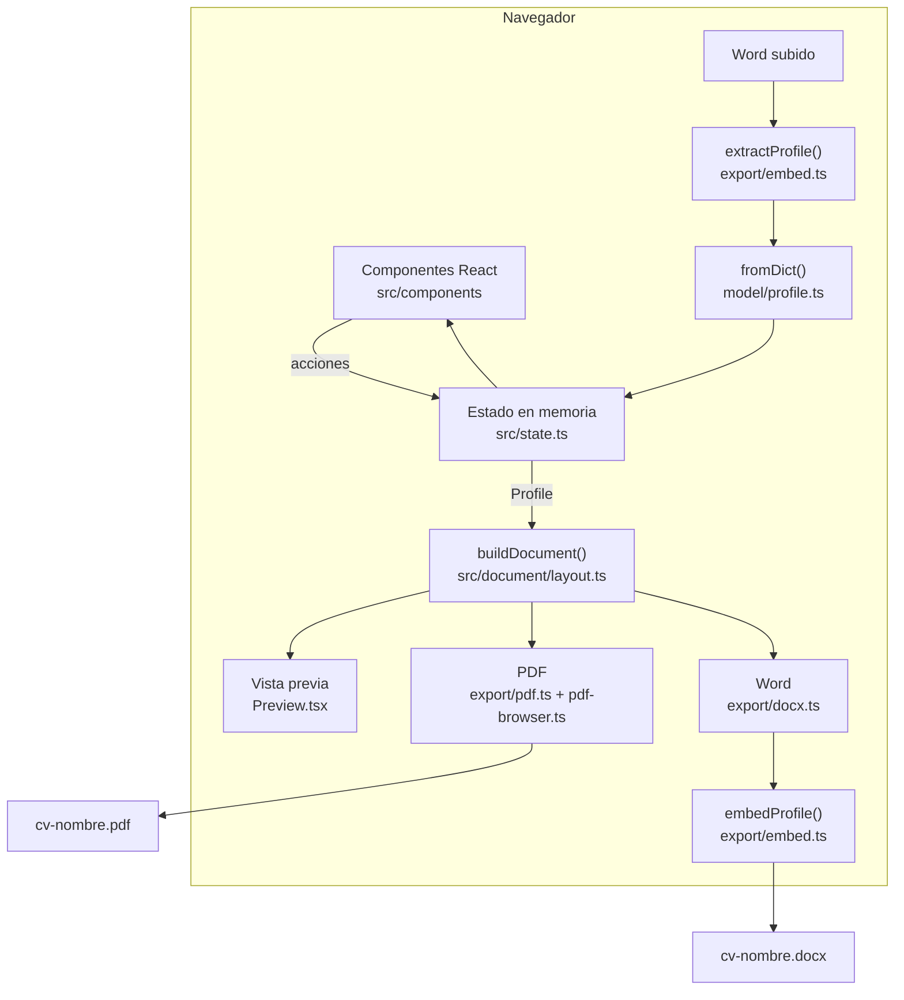

# Arquitectura

Este documento explica cómo está construido el Generador de CV y por qué. Para
instalarlo y publicarlo, consulta el [README](../README.md).

## Principios

1. **Los datos no salen del navegador.** No hay backend: la web es un conjunto de
   archivos estáticos y todo el trabajo ocurre en la pestaña de quien la usa.
2. **No se guarda nada.** El estado vive en memoria. Para continuar otro día, la
   persona se lleva su CV en el Word que descarga.
3. **Lo que se ve es lo que se exporta.** Una sola maqueta alimenta la vista
   previa, el PDF y el Word.

## Flujo de datos



## Módulos

| Módulo | Responsabilidad |
| --- | --- |
| `src/model/profile.ts` | Tipos del perfil, lectura tolerante (`fromDict`), visibilidad de secciones y `exportableProfile`. |
| `src/model/sections.ts` | Secciones del editor y campos de cada tipo de entrada. |
| `src/lib/validate.ts` | Avisos sobre viñetas (verbo de acción, primera persona, longitud, puntuación). |
| `src/lib/format.ts` | Rangos de fechas, URL legibles y destinos de enlace, nombre del archivo descargado. |
| `src/state.ts` | Reducer con el estado de la sesión: pantalla, perfil, sección abierta, cambios sin descargar. |
| `src/document/layout.ts` | `buildDocument`: del perfil a un documento de líneas. |
| `src/components/*` | Interfaz: inicio, barra superior, riel, editor, vista previa y diálogos. |
| `src/export/*` | Generación de PDF y Word, datos incrustados y lectura del Word subido. |
| `src/i18n/*` | Textos de la interfaz y títulos del CV en español e inglés. |
| `site.config.ts`, `vite/site-plugin.ts` | Metadatos de las páginas, sitemap, robots y cabecera o pie de las páginas estáticas. |

### El perfil

`Profile` usa nombres en `snake_case`, los mismos que la versión Streamlit, para
leer sus JSON sin traducción. `fromDict` reproduce `CVProfile.from_dict` de Python,
incluidos los alias heredados (`leadership`, `volunteering`, certificaciones como
texto, etc.). Una prueba compara su salida con la del modelo de Python sobre un
caso que cubre esos alias.

`active_sections` vacío significa «todo visible». `setVisibility` mantiene esa
convención y `exportableProfile` vacía las secciones ocultas.

### La maqueta compartida

`buildDocument(profile)` devuelve un `CVDocument`:

```ts
interface CVDocument {
  locale: "es" | "en";
  name: string;                       // «CV» si está vacío
  contact: { text: string; href: string }[];
  sections: { key: SectionKey; title: string; entries: DocLine[][] }[];
  empty: boolean;
}

type DocLine =
  | { kind: "line"; left: string; right: string; bold: boolean } // fechas o lugar a la derecha
  | { kind: "text"; text: string; label: string }                // «Etiqueta: texto»
  | { kind: "link"; text: string; href: string }
  | { kind: "bullets"; items: string[] };
```

- **Orden de las secciones:** educación, experiencia, liderazgo, habilidades e
  intereses, proyectos, voluntariado, certificaciones, premios y publicaciones.
- **Lo que no aparece:** las secciones ocultas y las entradas vacías.

Cada renderizador solo dibuja estas líneas:

| Salida | Medidas |
| --- | --- |
| Vista previa (`Preview.tsx`) | Hoja Carta con tamaños en `em`, escalada al ancho de la columna con unidades de contenedor (`cqw`). |
| PDF (`export/pdf.ts`) | Carta; márgenes de 0.5/0.2/0.42 in; 11 pt; 11 pt entre secciones y entradas; viñeta a 0.33 in y texto a 0.58 in, como la plantilla LaTeX original. |
| Word (`export/docx.ts`) | Las mismas medidas en twips que el generador python-docx: Calibri 11, tabulador derecho, borde bajo el nombre y viñetas con sangría de 839/360. |

Los módulos de PDF y Word se cargan con `import()` al pulsar «Descargar», así que
la página inicial no los descarga.

### Tipografía del PDF

El PDF incrusta «CV Doc Sans», una versión de Carlito reducida a latín y latín
extendido, sin hinting y **sin ligaduras**. Con ligaduras, el texto copiado o
leído por un ATS perdía letras («Automaticé» salía como «Automatcé»). Como Carlito
reserva su nombre en la licencia OFL, la versión modificada se llama de otra forma.
Detalles y comando en [`src/export/fonts/README.md`](../src/export/fonts/README.md).

## Formato de los datos dentro del Word

El Word descargado es un `.docx` normal con una parte Custom XML adicional, el
mecanismo estándar de Office Open XML para datos propios. Word la conserva al
editar y guardar; Google Docs no.

| Parte | Contenido |
| --- | --- |
| `customXml/itemN.xml` | `<cv:perfil xmlns:cv="urn:generador-cv:perfil" version="1">JSON</cv:perfil>`, con el JSON escapado como texto XML. |
| `customXml/itemPropsN.xml` | `ds:datastoreItem` con un GUID y la referencia al esquema `urn:generador-cv:perfil`. |
| `customXml/_rels/itemN.xml.rels` | Relación `customXmlProps` hacia `itemPropsN.xml`. |
| `word/_rels/document.xml.rels` | Relación `customXml` desde el documento hacia `../customXml/itemN.xml`. |
| `[Content_Types].xml` | `Override` para `itemPropsN.xml` y `Default` para `.xml` si falta. |

**Qué contiene el JSON:**

- Es `exportableProfile(profile)`: el perfil con las secciones ocultas vacías y
  `active_sections` vacío.
- Nunca incluye nada que el CV no muestre.

**Cómo se lee un Word subido** (`extractProfile` y `readCvFile`):

1. **Archivo:** solo `.docx`, de 5 MB como máximo.
2. **Búsqueda:** recorre `customXml/item*.xml` y acepta cualquier prefijo de
   espacio de nombres, porque Word puede reescribirlo.
3. **Versión:** si es mayor que la soportada, devuelve el error `newer`.
4. **Tamaño de los datos:** el JSON puede ocupar hasta 1 MB.
5. **Lectura:** el JSON pasa por `fromDict`, que descarta lo que no reconoce.
6. **Errores:** `not_docx`, `too_big`, `no_data`, `newer` o `broken`, cada uno con
   su mensaje en la interfaz.

Para cambiar el formato de forma incompatible, sube `VERSION` en `embed.ts` y
mantén la lectura de las versiones anteriores.

## Capas de privacidad

| Capa | Mecanismo |
| --- | --- |
| Código | `tests/privacy.test.ts` falla si `src/` usa `localStorage`, `sessionStorage`, `indexedDB`, `document.cookie`, `fetch`, `XMLHttpRequest`, `sendBeacon`, `WebSocket` o `EventSource`. |
| Navegador | La CSP de `vercel.json` incluye `connect-src 'none'`, `form-action 'none'`, `script-src 'self'` y `frame-ancestors 'none'`. `vite preview` sirve la misma CSP para probarla en local. |
| Recursos | Fuentes autoalojadas, íconos como SVG en el código y la fuente del PDF incrustada en su módulo. pdfmake rechaza cualquier URL (`setUrlAccessPolicy(() => false)`). |
| Exportación | El Word solo lleva los datos visibles. El PDF no lleva datos ocultos. |
| Alojamiento | Sin analítica ni cookies. Vercel solo registra datos técnicos de conexión, como explica la política de privacidad. |

## Páginas estáticas y SEO

El build es multipágina (`appType: "mpa"`): `index.html` (la app), las seis
páginas legales y `404.html`.

- **Páginas legales y 404:** HTML sin JavaScript que comparte los tokens y los
  componentes del sistema de diseño (`src/styles/pages.css`).
- **`vite/site-plugin.ts`:**
  - añade a cada página título, descripción, canonical, Open Graph, `hreflang`,
    íconos y el JSON-LD de la portada;
  - sustituye la cabecera, el pie y los marcadores (`%SITE_EMAIL%`,
    `%SITE_UPDATED%`);
  - genera `sitemap.xml` y `robots.txt`.

  Todo sale de `site.config.ts`.
- **En Vercel:** `cleanUrls` sirve `/privacidad` desde `privacidad.html`, y Vercel
  devuelve `404.html` con estado 404 para cualquier ruta desconocida.

## Decisiones

- **Web estática en lugar de Streamlit.** Streamlit necesita un servidor con
  WebSocket que Vercel no ofrece, y procesaría los datos fuera del navegador.
- **Custom XML en lugar de JSON aparte.** La persona maneja un único archivo, su
  CV, y no hay un archivo de datos suelto con información personal.
- **pdfmake en lugar de LaTeX o de imprimir.** LaTeX en WebAssembly pesa varios
  megas, e «Imprimir → PDF» depende de la configuración del navegador. pdfmake
  produce un PDF real en un clic y con buen texto seleccionable.
- **Sin almacenamiento, ni siquiera opcional.** Así la promesa es simple y
  comprobable, y no hay datos que proteger en equipos compartidos.

## Pruebas

| Archivo | Qué cubre |
| --- | --- |
| `tests/model.test.ts` | Paridad de `fromDict` con Python, visibilidad y `exportableProfile`. |
| `tests/validate.test.ts` | Casos del validador y utilidades de formato. |
| `tests/layout.test.ts` | Orden, contacto, entradas y títulos de la maqueta. |
| `tests/export.test.ts` | Ida y vuelta del Word, escapado, partes del paquete, errores de importación y PDF en Node. |
| `tests/privacy.test.ts` | Ni almacenamiento ni red en `src/`, y CSP estricta. |
| `tests/site.test.ts` | Páginas, metas, sitemap, robots, parejas de idioma, tamaño de imágenes y cabeceras. |

Además de las pruebas unitarias, antes de cada versión se revisa en el navegador
la accesibilidad (axe-core), los enlaces (`npm run check:links`) y el rendimiento
(Lighthouse), como describe el README.
